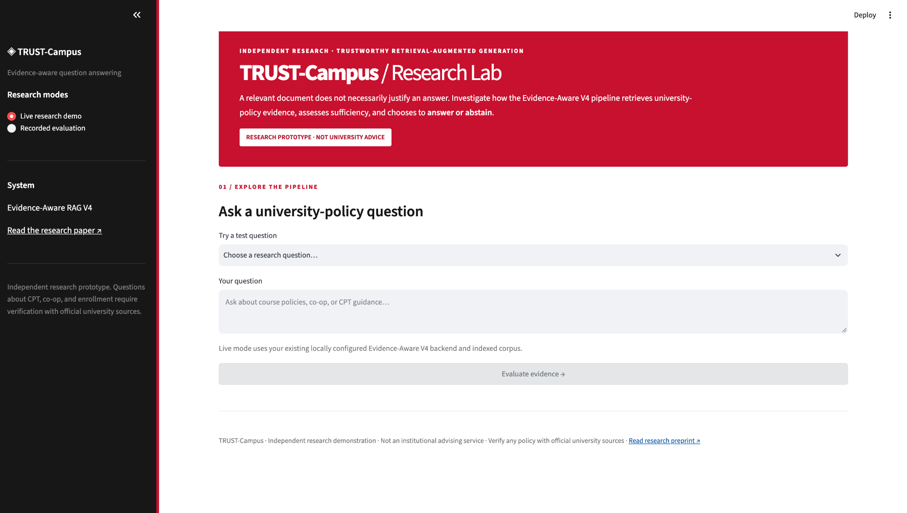
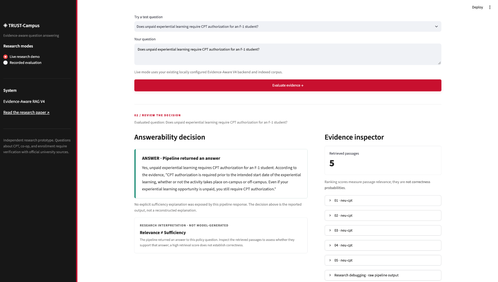
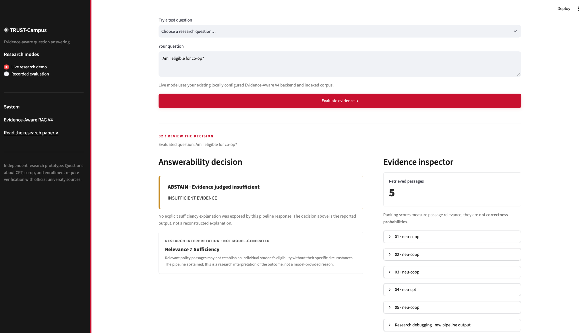
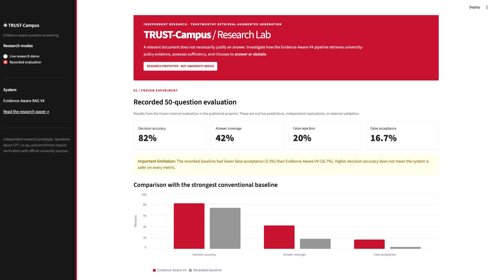
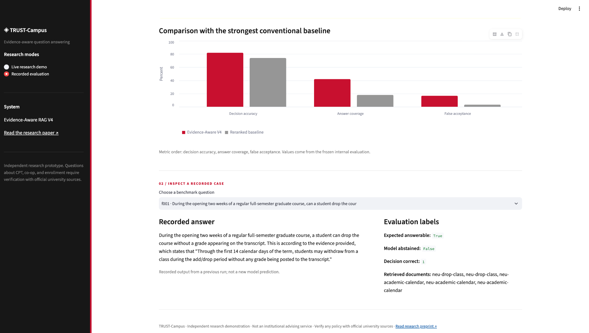
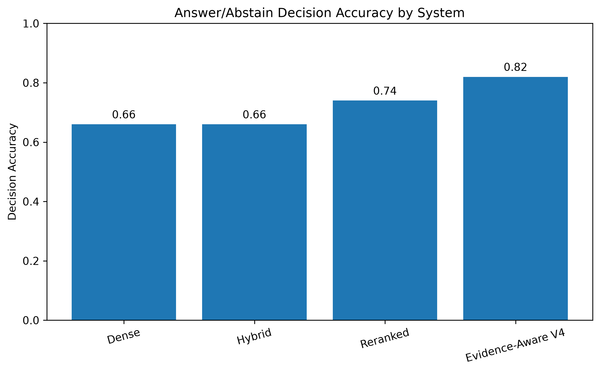
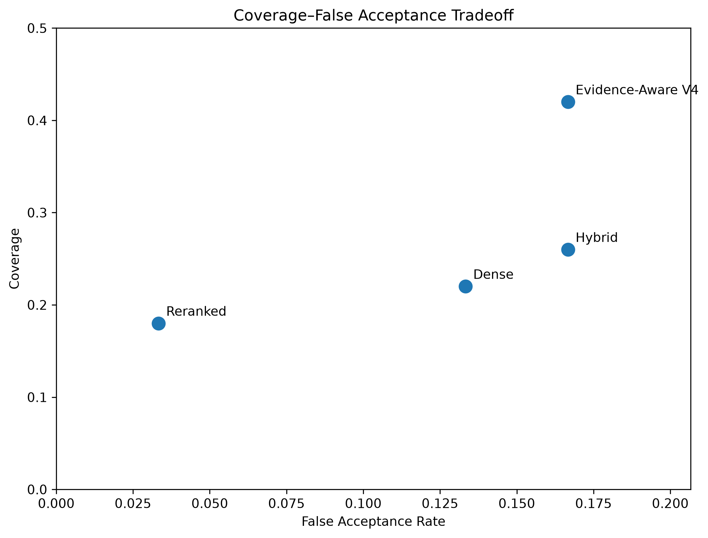
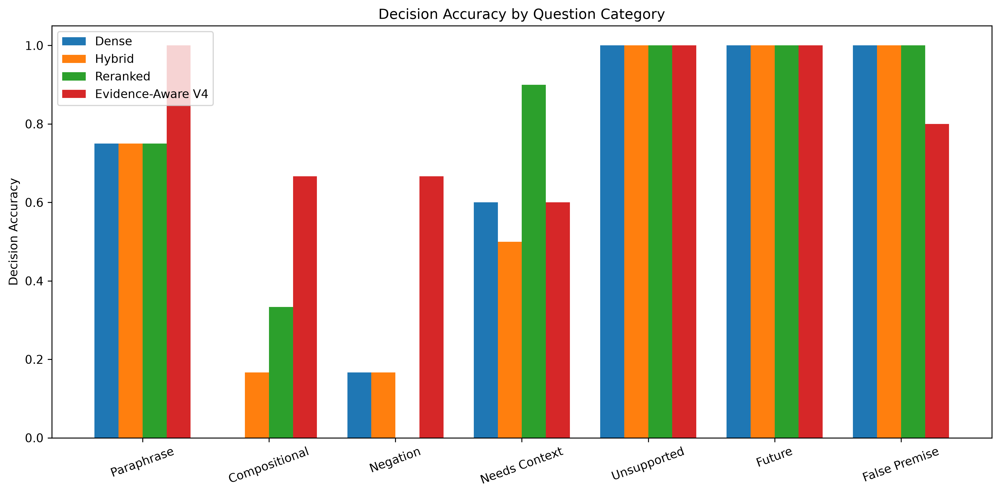

# TRUST-Campus

**Evidence-Aware Retrieval-Augmented Generation for Reliable University Information Access**

[Research preprint (Zenodo)](https://doi.org/10.5281/zenodo.23221797) · Independent research, 2026

> **Research question:** When is retrieved information *sufficient* to support an answer, rather than merely relevant to the question?

TRUST-Campus is an experimental retrieval-augmented generation (RAG) system for university-policy questions. It separates **finding relevant source passages** from **deciding whether those passages justify an answer**. When the system judges the evidence insufficient, it abstains instead of generating a potentially unsupported conclusion.

The project includes an Evidence-Aware RAG V4 pipeline, three retrieval-based baselines, a frozen 50-question evaluation, and a **Streamlit research interface** for inspecting live answer/abstain decisions and retrieved evidence.

**Status:** Independent research prototype and publicly archived preprint. Not an official Northeastern University service. Do not rely on its answers for academic, employment, or immigration decisions; verify current requirements with the responsible university office.

## Contents

- [Research contributions](#research-contributions)
- [Pipeline overview](#pipeline-overview)
- [Interactive research demo](#interactive-research-demo)
- [Implementation and reproducibility notes](#implementation-and-reproducibility-notes)
- [Evaluation design](#evaluation-design)
- [Error analysis and future directions](#error-analysis-and-future-directions)
- [Paper and citation](#paper-and-citation)

## Contents

- [Research contributions](#research-contributions)
- [Pipeline overview](#pipeline-overview)
- [Interactive research demo](#interactive-research-demo)
- [Implementation and reproducibility notes](#implementation-and-reproducibility-notes)
- [Evaluation design](#evaluation-design)
- [Error analysis and future directions](#error-analysis-and-future-directions)
- [Paper and citation](#paper-and-citation)

## At a glance

| Component | Description |
| --- | --- |
| Research focus | Evidence sufficiency, selective answering, abstention, and trustworthy RAG |
| Application domain | Course policies, graduate co-op guidance, and curricular practical training (CPT) |
| Proposed system | Evidence-Aware RAG V4 |
| Comparisons | Dense RAG, Hybrid RAG, and Reranked RAG |
| Evaluation | 50 frozen, project-constructed questions: 20 answerable and 30 unanswerable |
| Interface | Streamlit (`app.py`), using the existing V4 backend |
| Paper | [TRUST-Campus preprint](https://doi.org/10.5281/zenodo.23221797) |

## Research contributions

The paper makes three bounded, testable contributions:

1. **An explicit semantic sufficiency stage.** After retrieval, Evidence-Aware V4 assesses whether the available passages contain the conditions, scope, and policy relationships needed to justify answering the *specific* question. A high retrieval or reranking score alone does not trigger an answer.
2. **A structured answerability evaluation.** A frozen, researcher-constructed 50-question set includes paraphrase, composition, negation, missing personal context, unsupported requests, future questions, and false premises. The design targets both over-answering and excessive abstention.
3. **A comparative analysis of selective answering.** Dense, hybrid, reranked, and evidence-aware systems are assessed under the same evaluation definitions, emphasizing decision accuracy, coverage, false rejection, and false acceptance alongside token F1.

These are contributions **within this experimental setting**, not claims of a universal verification algorithm or general-purpose policy advisor.

### How the proposed approach differs

| System | Main distinguishing feature | Where answerability is handled |
| --- | --- | --- |
| Dense RAG | Dense retrieval followed by generation | Conventional retrieval-to-generation flow |
| Hybrid RAG | Combines complementary retrieval signals | Conventional retrieval-to-generation flow |
| Reranked RAG | Reranks candidate passages before generation | Conventional retrieval-to-generation flow |
| **Evidence-Aware V4** | Adds a task-specific semantic sufficiency decision after retrieval | **Explicit answer/abstain step before generation** |

The key research distinction is **semantic support versus topical relevance**: a policy paragraph can discuss CPT yet still lack the individual facts needed to decide whether a particular student is eligible.

### Methodological scope

As described in the preprint, the sufficiency layer evaluates whether retrieved evidence contains the necessary **conditions, scope, and policy relationships** for the requested conclusion. It is intended to reject unsupported, future, or context-dependent queries while permitting direct, compositional, and negated conclusions when supported. This is a *task-specific decision mechanism*, **not** a learned universal verifier or a proof that every returned answer is correct. Source-level implementation details belong in `src/rag_evidence_aware_v4.py` and `src/semantic_sufficiency.py`.

## Pipeline overview

A retrieved policy document can be on-topic without answering the *specific* question asked. For example, a document explaining CPT eligibility requirements does not establish whether an individual student meets all those requirements.

TRUST-Campus introduces a **task-specific semantic evidence-sufficiency decision** between retrieval and response generation:

```text
User question
      |
Retrieval and reranking
      |
Candidate evidence passages
      |
Evidence-sufficiency decision
      |
      +---- Sufficient --------> Generate a grounded answer
      |
      +---- Insufficient ------> Abstain
```

The sufficiency mechanism is **not** claimed to be a general-purpose formal verifier or a universal guarantee of factual correctness. It is evaluated within the university-policy setting described in the paper.

## Interactive research demo

The Streamlit UI offers two modes:

**Live research demo**
- Ask a university-policy question or choose an example.
- Run the existing Evidence-Aware RAG V4 pipeline.
- See the returned **ANSWER** or **ABSTAIN** decision.
- Inspect retrieved text, document/chunk identifiers, and retrieval/reranking scores.
- View research interpretation separately from the pipeline's actual output. Retrieval scores indicate *relevance*, not answer correctness probabilities.

**Recorded evaluation**
- Review metrics from the project's **previously completed**, frozen 50-question experiment.
- Compare Evidence-Aware V4 with the strongest conventional baseline using correctly grouped bars.
- Inspect saved questions, responses, decision labels, and retrieved document IDs.

The live demo requires local model services and indexed data; the recorded evaluation is a display of prior results, **not** a fresh benchmark run.

### Example questions

| Question | Example observed outcome |
| --- | --- |
| Does unpaid experiential learning require CPT authorization for an F-1 student? | **ANSWER** in a local demo run |
| Am I eligible for co-op? | **ABSTAIN** in a local demo run, because individual eligibility information is missing |

These are illustrative local outputs, not proof of general accuracy. Individual model responses can vary by configuration.

### Interface screenshots

The following screenshots show the **locally running Streamlit research interface**. They are not a publicly hosted service. The university-inspired red-and-white appearance does not imply Northeastern University endorsement.

**Research dashboard — live question input and exploration modes**



**Answer decision — generated response and inspectable retrieved passages**



**Abstain decision — retrieved evidence is insufficient for individual eligibility**



**Recorded evaluation — aggregate metrics and baseline comparison**



## Implementation and reproducibility notes

The repository's research implementation and experiment scripts are separate from the Streamlit presentation layer. The UI imports the existing V4 class, displays the actual output of `answer(question)`, and reads previously recorded evaluations for its comparison view.

**What is documented here:** the high-level pipeline, available entry points, benchmark/result paths, and the frozen-source comparison commands.

**What still needs a verified environment specification:** exact generator and embedding model IDs/versions, index creation or acquisition steps, model service startup, random seeds (where applicable), and the commands needed to rebuild all artifacts from raw documents. Those details should be added only after checking the actual repository configuration and reproducing the commands. The present README does **not** claim full push-button reproduction on a fresh machine.

## Implementation and reproducibility notes

The repository's research implementation and experiment scripts are separate from the Streamlit presentation layer. The UI imports the existing V4 class, displays the actual output of `answer(question)`, and reads previously recorded evaluations for its comparison view.

**What is documented here:** the high-level pipeline, available entry points, benchmark/result paths, and the frozen-source comparison commands.

**What still needs a verified environment specification:** exact generator and embedding model IDs/versions, index creation or acquisition steps, model service startup, random seeds (where applicable), and the commands needed to rebuild all artifacts from raw documents. Those details should be added only after checking the actual repository configuration and reproducing the commands. The present README does **not** claim full push-button reproduction on a fresh machine.

## Reproducing the local demo

From the repository root:

```bash
python3 -m venv .venv
source .venv/bin/activate
python -m pip install -r requirements.txt
python -m pip install streamlit altair pandas
python -m streamlit run app.py
```

Open **http://localhost:8501** if the browser does not open automatically.

**Prerequisites for live inference:** The existing V4 implementation in `src/`, its indexed document corpus, and the local model/runtime services required by that implementation. These dependencies must be configured using the backend's existing setup; the Streamlit interface does not download models, construct missing indexes, or substitute fabricated results.

The UI imports `src.rag_evidence_aware_v4` and calls the selected V4 pipeline's `answer(question)` method. It does not change the frozen research model or evaluation data.

**Troubleshooting:** If a live question fails, confirm that the virtual environment is active, the backend dependencies are installed, the indexed files exist, and the local model service is running. The UI reports failures rather than manufacturing an answer.

## Evaluation design

The frozen internal evaluation includes **50 project-constructed questions**, divided into seven categories:

| Category | Questions | Expected answerability |
| --- | ---: | --- |
| Paraphrase | 8 | Answerable |
| Compositional | 6 | Answerable |
| Negation | 6 | Answerable |
| Needs context | 10 | Unanswerable |
| Unsupported | 10 | Unanswerable |
| Future | 5 | Unanswerable |
| False premise | 5 | Unanswerable |
| **Total** | **50** | **20 answerable / 30 unanswerable** |

This is a **frozen internal evaluation set**, not an independently collected external benchmark.

### Reported results

Values below are from the archived experiment described in the preprint; they are **not continuously recomputed by the UI**.

| System | Retrieval hit | Coverage | Decision accuracy | False rejection | False acceptance | Token F1 |
| --- | ---: | ---: | ---: | ---: | ---: | ---: |
| Dense RAG | 1.000 | 0.220 | 0.660 | 0.650 | 0.133 | 0.507 |
| Hybrid RAG | 1.000 | 0.260 | 0.660 | 0.600 | 0.167 | 0.480 |
| Reranked RAG | 1.000 | 0.180 | 0.740 | 0.600 | **0.033** | **0.523** |
| **Evidence-Aware RAG V4** | **1.000** | **0.420** | **0.820** | **0.200** | 0.167 | 0.443 |

Compared with Reranked RAG, Evidence-Aware V4 improved **decision accuracy (74% → 82%)** and **answer coverage (18% → 42%)**, while reducing **false rejection (60% → 20%)**.

**Critical trade-off:** V4's false-acceptance rate was **16.7%**, compared with **3.3%** for Reranked RAG. Thus, **higher overall decision accuracy does not imply that V4 was safer on every metric**. Personalized context-dependent questions were a central failure mode.

All compared systems had a retrieval hit rate of **1.000 on questions with gold supporting documents**. In this setting, identifying the correct document was not the same as deciding whether the document justified an answer.

### Inspecting individual recorded cases

The UI also displays the saved answer, retrieved-document identifiers, and expected versus predicted decision labels for a selected frozen benchmark example. These are historical evaluation outputs, **not fresh model predictions**.



### Category-level decision accuracy

| Category | Dense | Hybrid | Reranked | Evidence-Aware V4 |
| --- | ---: | ---: | ---: | ---: |
| Paraphrase | 0.750 | 0.750 | 0.750 | **1.000** |
| Compositional | 0.000 | 0.167 | 0.333 | **0.667** |
| Negation | 0.167 | 0.167 | 0.000 | **0.667** |
| Needs context | 0.600 | 0.500 | **0.900** | 0.600 |
| Unsupported | 1.000 | 1.000 | 1.000 | 1.000 |
| Future | 1.000 | 1.000 | 1.000 | 1.000 |
| False premise | **1.000** | **1.000** | **1.000** | 0.800 |

### Evaluation figures

If the committed files are present, GitHub will display the following existing research figures:







## Reproduce the recorded evaluation

The published frozen question set and result records use these paths:

```text
data/benchmark/questions_final_50_frozen.jsonl
data/benchmark/questions_final_50_baseline.jsonl
results/final_benchmark_dense_50q.jsonl
results/final_benchmark_hybrid_50q.jsonl
results/final_benchmark_reranked_50q.jsonl
results/final_benchmark_v4_50q.jsonl
```

The baseline evaluators use the benchmark path configured in `src/config.py`. Verify that the path points to the intended frozen baseline-compatible input before executing them.

```bash
python -m src.evaluate
python -m src.evaluate_hybrid
python -m src.evaluate_reranked
python -m src.evaluate_evidence_aware_v4 data/benchmark/questions_final_50_frozen.jsonl
```

Generate the existing research figures with:

```bash
python scripts/generate_final_figures.py
```

The V4 implementation was frozen for the reported evaluation. To check whether active and frozen source copies match:

```bash
cmp -s src/rag_evidence_aware_v4.py src/rag_evidence_aware_v4_frozen.py && echo "RAG SAME" || echo "RAG DIFFERENT"
cmp -s src/semantic_sufficiency.py src/semantic_sufficiency_v4_frozen.py && echo "SEMANTIC SAME" || echo "SEMANTIC DIFFERENT"
```

These commands compare files; they **do not independently reproduce the published metrics**. Re-running the evaluations may require the original model, corpus, indexes, and configuration.

## Metrics

| Metric | Definition |
| --- | --- |
| Retrieval hit rate | Gold supporting document appears among retrieved passages, when gold document IDs exist |
| Coverage | Fraction of questions for which the system answers rather than abstains |
| Decision accuracy | Fraction where the system makes the correct answer-versus-abstain decision |
| False rejection rate | Fraction of answerable questions incorrectly rejected |
| False acceptance rate | Fraction of unanswerable questions incorrectly answered |
| Token F1 | Lexical overlap with the gold answer for answered, answerable questions; not a semantic correctness guarantee |

## Repository map

```text
trust-campus/
├── app.py
├── screenshots/
├── screenshots/
├── data/
│   └── benchmark/
├── experiments/
├── figures/
├── paper/
│   ├── TRUST_Campus_Research_Paper.pdf
│   └── TRUST_Campus_Research_Paper.docx
├── results/
├── scripts/
│   └── generate_final_figures.py
├── src/
├── requirements.txt
└── README.md
```

The repository includes additional files within `src/`, `data/`, and `results/`. The listing above highlights the main research and demo entry points, not every file.

## Error analysis and future directions

The paper reports four false rejections by Evidence-Aware V4 (`f009`, `f011`, `f019`, `f020`), concentrated in compositional and negated policy questions. These cases involve recognizing when multiple retrieved statements jointly support a conclusion.

False acceptances are especially important: **four occur in the needs-context category**, where relevant general policy information does not determine a student's personal eligibility. The paper also reports **one false acceptance in the false-premise category**. This shows why high retrieval quality must not be equated with reliable personalized conclusions.

Two priorities for future work follow directly from these results:

- Represent **missing user context** explicitly and ask targeted clarification questions instead of guessing eligibility.
- Study **risk-calibrated abstention** and broader, independently gathered cross-institution evaluation before considering higher-stakes use.

## Error analysis and future directions

The paper reports four false rejections by Evidence-Aware V4 (`f009`, `f011`, `f019`, `f020`), concentrated in compositional and negated policy questions. These cases involve recognizing when multiple retrieved statements jointly support a conclusion.

False acceptances are especially important: **four occur in the needs-context category**, where relevant general policy information does not determine a student's personal eligibility. The paper also reports **one false acceptance in the false-premise category**. This shows why high retrieval quality must not be equated with reliable personalized conclusions.

Two priorities for future work follow directly from these results:

- Represent **missing user context** explicitly and ask targeted clarification questions instead of guessing eligibility.
- Study **risk-calibrated abstention** and broader, independently gathered cross-institution evaluation before considering higher-stakes use.

## Limitations and responsible use

- The evaluation uses **50 questions** from a narrowly scoped, researcher-constructed university-policy benchmark.
- Category sizes are small, and the results do not establish broad generalization to other institutions or domains.
- **False acceptance remains a concern:** V4 performed worse on this measure than the reranked baseline.
- Questions requiring personal context remain challenging.
- Retrieval relevance scores are **not** confidence or correctness probabilities.
- Token F1 is a lexical measure and does not establish semantic correctness.
- The policy corpus may become outdated. This prototype should never be used as a source of official CPT, co-op, immigration, or academic advising decisions.

## Paper and citation

If you use or discuss the project, please cite the preprint. A BibTeX entry is provided for convenience; its metadata should be cross-checked with the final Zenodo record before use in a manuscript.

```bibtex
@misc{prabhakar2026trustcampus,
  author       = {Prabhakar, Mridula},
  title        = {TRUST-Campus: Evidence-Aware Retrieval-Augmented Generation for Reliable University Information Access},
  year         = {2026},
  publisher    = {Zenodo},
  doi          = {10.5281/zenodo.23221797},
  url          = {https://doi.org/10.5281/zenodo.23221797},
  note         = {Independent research preprint}
}
```

If you use or discuss the project, please cite the preprint. A BibTeX entry is provided for convenience; its metadata should be cross-checked with the final Zenodo record before use in a manuscript.

```bibtex
@misc{prabhakar2026trustcampus,
  author       = {Prabhakar, Mridula},
  title        = {TRUST-Campus: Evidence-Aware Retrieval-Augmented Generation for Reliable University Information Access},
  year         = {2026},
  publisher    = {Zenodo},
  doi          = {10.5281/zenodo.23221797},
  url          = {https://doi.org/10.5281/zenodo.23221797},
  note         = {Independent research preprint}
}
```

**Mridula Prabhakar.** *TRUST-Campus: Evidence-Aware Retrieval-Augmented Generation for Reliable University Information Access.* Independent research preprint, 2026. Zenodo. https://doi.org/10.5281/zenodo.23221797

**Publication status:** Public preprint; not described here as peer-reviewed.

## Repository reuse and licensing

The README does not imply an open-source license. **Check for an existing `LICENSE` file** before adding or choosing a license; public visibility on GitHub does not automatically grant reuse permissions. Model and university-document licenses may also constrain redistribution.

## Repository reuse and licensing

The README does not imply an open-source license. **Check for an existing `LICENSE` file** before adding or choosing a license; public visibility on GitHub does not automatically grant reuse permissions. Model and university-document licenses may also constrain redistribution.

## Author

**Mridula Prabhakar**
Independent research in trustworthy AI, RAG, evidence sufficiency, reliable software systems, and verification.

[Research paper](https://doi.org/10.5281/zenodo.23221797) · [Portfolio](https://mridulapbk08.github.io/)
